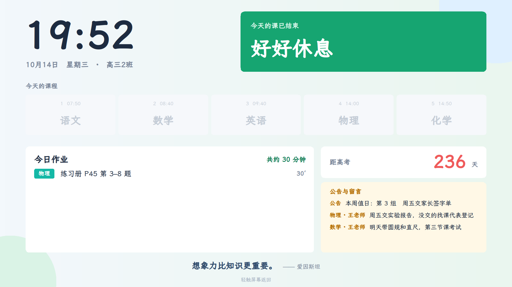
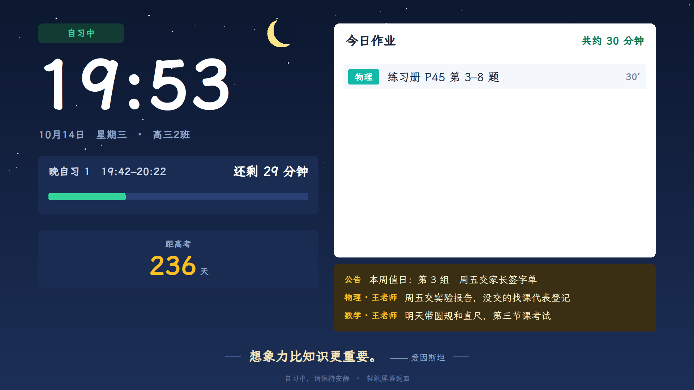
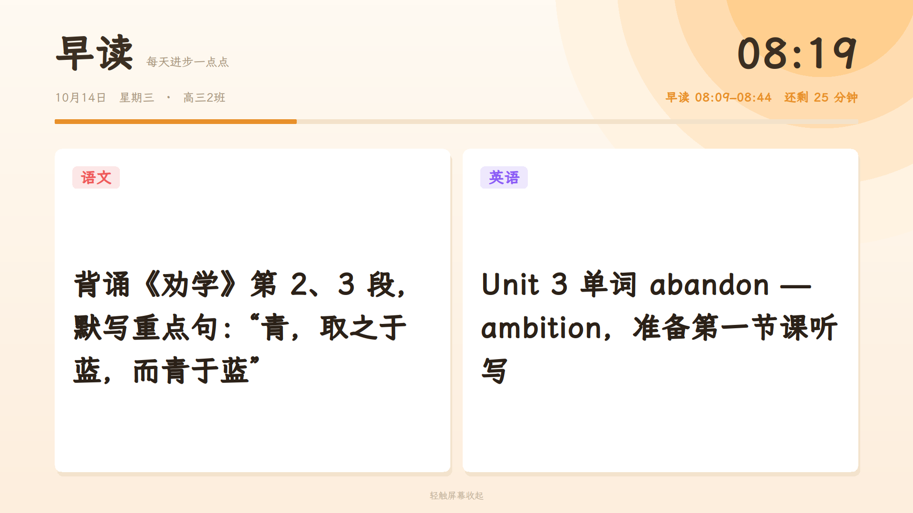

# 班级助手

给教室一体机（大屏）用的班级小助手。老师在手机或电脑上点一下，教室大屏就会弹出消息、语音播报；没人用的时候，大屏自动显示今天的课程、作业、倒计时和留言。

一位高中老师为自己的班写的，现在也在别的学校用。

| 白天看板 | 晚自习看板 | 早读 |
|---|---|---|
|  |  |  |

## 能做什么

- **喊话**：叫学生到办公室、发通知，大屏弹窗 + 语音播报（上课时只在角落显示，不打扰上课）；可以定时发送，也可以设成每天 / 每周重复的提醒
- **作业**：各科老师布置作业，选"今天交 / 明天交"，班主任能看到每天总时长；课代表在大屏上登记谁没交
- **早读**：老师提前填好早读内容，到点大屏整屏显示
- **大屏看板**：课程表（含晚自习）、高考倒计时、任课老师留言、每日一句；考试时显示考试大屏
- **课堂工具**：倒计时、随机抽号、发文件到大屏（Word、PDF、PPT、图片、视频）、按考试成绩喊学生面批
- **班务**：积分、值日、考勤
- **多班级、多老师**：班主任扫码邀请任课老师加入；每个班可以有自己的作息时间和科目
- **一体机**：支持麒麟 / 统信（Linux）和 Windows，一行命令安装，开机自动运行，自动更新；也能一键卸载或远程卸载

## 两个版本，选一个

| | 云服务器版 | 局域网版 |
|---|---|---|
| 服务器 | 租一台云服务器（一年几十元起） | 学校里一台一直开着的 Windows 电脑 |
| 要不要联网 | 要 | **不用**，校园网内就能用 |
| 老师在校外能不能用 | 能 | 不能（只能在学校里用） |
| 语音 | 在线语音（可接腾讯云语音合成） | 电脑自带的中文语音（"慧慧"） |
| 安装 | 在服务器上运行一条命令 | 下载压缩包，解压后双击 |

两个版本是同一套代码，功能一样。

### 局域网版（Windows 电脑，免安装、免联网）

1. 在 [Releases](https://github.com/zhouqingge0909/class-assistant/releases) 下载 **`class-assistant-lan-windows.zip`**（班级助手局域网版），"全部解压"到学校一台一直开着的 Windows 电脑上（Win7 / 10 / 11，64 位）。
2. 双击 **「启动班级助手」**。第一次会问"是否允许此应用对你的设备进行更改"，点"是"（在防火墙里放行，手机和一体机才连得上）。
3. 黑色窗口里会显示**工作台地址**（如 `http://192.168.1.23:8080/`）和**管理员密码**。老师手机连上学校 Wi-Fi，打开这个地址登录，建班、填名单。
4. 在工作台「班级管理」→「一体机」复制安装命令，到教室一体机上运行。一体机不用联网，需要的东西（包括 Windows 一体机要用的 Python）都从这台电脑下载。
5. 双击 **「开机自动启动-打开」**，以后开机就自动运行。

要注意：这台电脑要一直开着（班级助手开着时电脑不会自动睡眠），**最好请网管把它的 IP 地址固定下来**，不然地址变了一体机和老师手机就找不到它。压缩包里的「使用说明.txt」有更新方法和常见问题。

> Mac / Linux 电脑也能当局域网服务器：装好 Python 3.8 以上，`python3 -m pip install --user pillow qrcode`，然后在代码文件夹里运行 `python3 server.py`。

### 云服务器版

需要一台有公网 IP 的云服务器（最低配就够，系统选 **Ubuntu 22.04 / 24.04 纯净镜像**），并在云服务器的防火墙里放行 **TCP 80** 端口。

在服务器的命令窗口里运行：

```bash
git clone https://github.com/zhouqingge0909/class-assistant.git
cd class-assistant
sudo bash setup.sh
```

大约 5 分钟装好，最后会显示**工作台地址**和**管理员密码**。用浏览器打开工作台地址登录，建班、填名单，然后在工作台「班级管理」里点「一体机」，把安装命令复制到教室一体机上运行即可。

以后要更新：在 `class-assistant` 文件夹里 `git pull`，再运行一次 `sudo bash setup.sh`，班级数据和密码都会保留。

> 装好以后，打开 `http://你的服务器IP/setup` 有图文教程，可以转发给别的老师。

## 文件说明

| 文件 | 作用 |
|---|---|
| `server.py` | 服务器（只用 Python 标准库，另外用到 pillow、qrcode；云服务器版可选 edge-tts） |
| `static/` | 老师工作台、注册页、教程页等网页 |
| `kylin/` | 一体机接收端（`receiver.py`）和安装、卸载脚本（Linux 用 `.sh`，Windows 用 `.ps1`） |
| `lan/` | 局域网版：Windows 启动脚本、使用说明，和打包脚本 `build-windows.sh`（生成自带 Python 的压缩包） |
| `setup.sh` | 云服务器版：在 Ubuntu 服务器上一键安装 / 更新 |
| `fonts.sh` | 云服务器版安装时下载网页字体和一体机字体（不随代码分发；局域网版用系统字体） |
| `pack.sh` | 把程序打成安装包 `dist/class-assistant.tar.gz`，放到自己服务器上给别人下载 |
| `deploy.sh` / `deploy-public.sh` | 从自己电脑部署到服务器（自用 / 多学校公共模式） |

第一次运行时会自动生成 `config.json`（管理员密码、一体机密钥、作息时间等）。**这个文件和 `students.csv`、`data/` 里是你学校的密码和学生信息，不要上传到网上。**

自己打局域网版压缩包：在 Mac 或 Linux 上运行 `bash lan/build-windows.sh`，生成 `lan/out/class-assistant-lan-windows.zip`。

## 隐私

- 学生信息只存在你自己的服务器（或学校那台电脑）上，程序不会发到别的地方。
- 云服务器版的语音播报用在线语音合成，只会把要播报的那句话发过去；局域网版完全不联网。

## 许可证

[MIT](LICENSE)：可以自由使用、修改和分发，请保留原作者署名。
